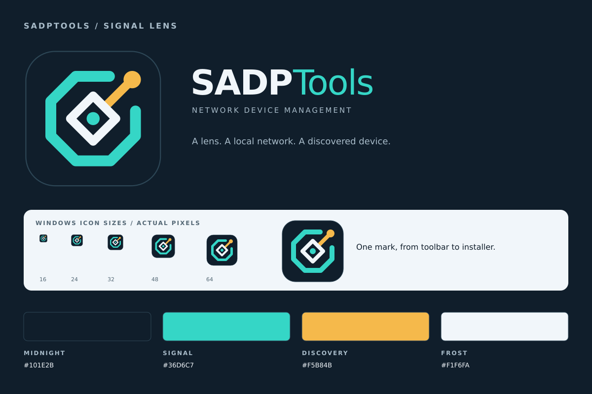

# SADPTools branding

**Signal Lens** is an original vector mark for SADPTools. An angular camera lens
sits inside an open network ring. A connected amber point represents a discovered
device. The symbol has no tiny lettering and is used consistently in the app,
Windows executable, shortcuts, installer and uninstaller.



## Artwork and colour

| Colour | Value | Use |
| --- | --- | --- |
| Midnight | `#101E2B` | Icon background, installer sidebar |
| Signal | `#36D6C7` | Network ring, dark-theme accents |
| Discovery | `#F5B84B` | Discovered-device point, inactive-device emphasis |
| Frost | `#F1F6FA` | Lens and light foreground |
| Deep teal | `#08796F` | Light-theme accents and filled buttons |

`build/brand/mark.svg` is the editable symbol. `build/brand/generate.py` composes
the tile, wordmarks, installer artwork and preview from that single source.

- `build/appicon.svg` and `build/appicon.png`: application tile and 512px PNG.
- `frontend/src/assets/brand-icon.svg`: identical tile bundled by Vite, used in
  the main header, top-right About button, About heading, empty inventory and
  favicon. It does not load from the internet.
- `build/brand/logo-dark.svg` and `logo-light.svg`: transparent horizontal
  wordmarks for dark and light backgrounds.
- `build/windows/icon.ico`: transparent 32-bit icons at 16, 20, 24, 32, 40, 48,
  64, 128 and 256 pixels. Windows resource generation and NSIS use this same file.
- `build/windows/installer-sidebar.bmp` and `installer-header.bmp`: opaque 24-bit
  artwork at twice the standard NSIS dimensions, scaled by Modern UI for the
  welcome/finish pages and installer/uninstaller headers.

Keep the icon square, preserve the clear space around the symbol and use the
correct wordmark for its background. Application text uses the system UI font;
exported wordmarks use DejaVu Sans with a sans-serif fallback.

## Regenerating assets

Generated assets are committed, so ordinary Windows/Linux builds need no SVG
renderer, image editor or new Python packages. On a Linux authoring host:

```sh
make branding
python3 build/brand/generate.py --check
```

The generator uses Python's standard library with system librsvg and Cairo. It
writes PNG, ICO and BMP directly, with no timestamp metadata. The exports were
generated and checked on Sparx with Python 3.14, librsvg
`2.61.3+dfsg-3ubuntu0.1`, Cairo `1.18.4-3` and DejaVu fonts `2.37-8build1`.
Use those renderer/font versions for byte-identical exports. `--check` renders
again without writing and compares every export to the committed files.

If the authoring libraries are missing on Ubuntu/Debian, the installation command
is `sudo apt install librsvg2-2 libcairo2 fonts-dejavu-core`. This is an optional
authoring requirement; the build does not install packages automatically.

After artwork changes, rebuild with `make windows-installer` and `make linux-gui`.
NSIS's [Modern UI documentation](https://nsis.sourceforge.io/Docs/Modern%20UI%202/Readme.html)
describes its icon/bitmap inputs. Wails icon settings follow the pinned v3 API and
the [window options documentation](https://v3.wails.io/features/windows/options/).

## Linux desktop integration

GTK4 resolves launcher/taskbar icons through the desktop entry and icon theme.
Setting PNG bytes on a window alone does not supply a GTK4 launcher icon. The
app's GTK ID and `build/linux/io.github.terminaladdict.sadptools.desktop` match.

To install a built Linux app into your own account (with `~/.local/bin` on PATH):

```sh
install -Dm755 bin/SADPTools-linux-amd64 "$HOME/.local/bin/SADPTools"
install -Dm644 build/appicon.svg "$HOME/.local/share/icons/hicolor/scalable/apps/io.github.terminaladdict.sadptools.svg"
install -Dm644 build/linux/io.github.terminaladdict.sadptools.desktop "$HOME/.local/share/applications/io.github.terminaladdict.sadptools.desktop"
```

The app also embeds the PNG for Wails' application icon and the GTK3 window-icon
path. Windows uses the embedded executable resources. No Linux desktop entry is
installed just by building the project.
